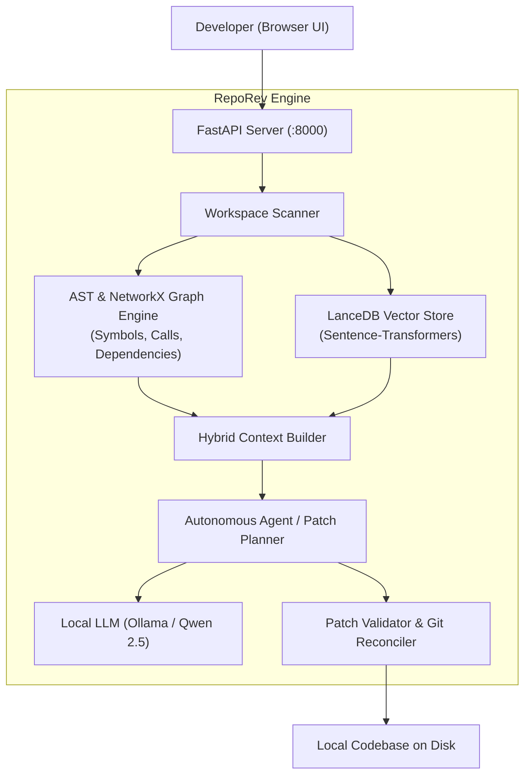

# ⚡ RepoRev (Code Intelligence)

> **Your codebase. Your machine. Your AI.**  
> A 100% private, on-device AI assistant that understands your entire software repository through AST structural call graphs and semantic vector search.

---

## 🌟 Why RepoRev?

Most AI coding tools upload your proprietary source code to cloud servers or rely on simple keyword matching that loses context in complex projects.

**RepoRev runs completely on your local machine:**
- 🔒 **Zero Data Leakage:** Your code, embeddings, and chat history never leave your computer.
- 🧠 **Dual-Engine Code Understanding:** Combines Abstract Syntax Tree (AST) call graphs with vector embeddings so the AI understands real function flows, not just isolated snippets.
- 🛠️ **Autonomous Safe Patches:** Plans, creates, and validates reviewable Git diffs with automated syntax checks before touching your files.
- 🎨 **Modern Bolt-Inspired UI:** Sleek, high-performance dark glassmorphism interface with real-time telemetry.

---

## 📸 Key Features

| Feature | What It Does |
| :--- | :--- |
| **AST Call & Dependency Graphs** | Traces caller/callee relationships, imports, and symbol definitions across hundreds of files using NetworkX. |
| **Semantic Vector Search** | Indexes code meaning and intent locally with LanceDB and Sentence-Transformers. |
| **Multi-Workspace Support** | Seamlessly register, scan, and switch between multiple local Git or non-Git codebases. |
| **Safe Patch Lifecycle** | Generates reviewable diffs, verifies syntax, and lets you inspect and approve changes with one click. |
| **Local LLM Powered** | Connects directly to local models (e.g. Qwen 2.5, DeepSeek, Llama 3) via Ollama. |

---

## 🚀 Quickstart Guide

### 1. Prerequisites
- **Python 3.10+** installed
- **[Ollama](https://ollama.com/)** installed and running with your preferred model (recommended: `qwen2.5:7b` or `qwen2.5:14b`):
  ```bash
  ollama run qwen2.5:7b
  ```

---

### 2. Installation

1. **Clone or navigate to the repository directory:**
   ```bash
   git clone https://github.com/your-username/RepoRev.git
   cd RepoRev
   ```

2. **Create and activate a virtual environment:**
   - **Windows:**
     ```powershell
     python -m venv .venv
     .\.venv\Scripts\activate
     ```
   - **macOS / Linux:**
     ```bash
     python3 -m venv .venv
     source .venv/bin/activate
     ```

3. **Install dependencies:**
   ```bash
   pip install -r requirements.txt
   ```

---

### 3. Launching RepoRev

#### Option A: One-Click Launch (Windows)
Double-click `run.bat` or run:
```cmd
run.bat
```

#### Option B: Manual Launch (Windows / macOS / Linux)
```bash
uvicorn app.main:app --host 127.0.0.1 --port 8000 --reload
```

Now open your browser and navigate to:  
👉 **`http://127.0.0.1:8000/dashboard`**

---

## 🖥️ How to Use

### 1. Add Your Codebase
1. Open the dashboard.
2. In the left sidebar under **Workspace**, click **+ Add**.
3. Enter a friendly name and the absolute directory path to your local repository.
4. RepoRev will automatically scan the project files and build initial state hashes.

### 2. Build the Indices
1. Click **Repository** in the sidebar.
2. Click **Rebuild structural** to parse AST symbols and call flows.
3. Click **Rebuild semantic** to generate vector embeddings.
*(You only need to rebuild when major file changes happen; the sidebar shows if the index is **Fresh** or **Needs refresh**).*

### 3. Chat with Your Codebase
Go to **Chat** and ask questions in plain English:
- *"Where is customer authentication handled and what is the call flow?"*
- *"Trace how discounted prices are calculated during cart checkout."*
- *"Explain the project structure and summarize the entry points."*

### 4. Create Safe Code Patches
1. Click the **Plan** button in the chat input toolbar (it toggles to *Planning on*).
2. Enter the task or bugfix you want to implement.
3. RepoRev will inspect the relevant files, formulate a solution, and generate a reviewable patch.
4. Inspect the generated unified diff, review automated syntax checks, and click **Approve** to apply the patch cleanly!

---

## ⚙️ Configuration (`.env`)

You can customize behavior by creating a `.env` file in the project root:

```env
# URL where your local LLM server is running (Ollama default)
OUTRIGHTBOT_LLM_BASE_URL=http://127.0.0.1:11434

# Model name to use in Ollama
OUTRIGHTBOT_LLM_MODEL=qwen2.5:7b

# Context window size in tokens
OUTRIGHTBOT_LLM_NUM_CTX=8192

# Request timeout in seconds
OUTRIGHTBOT_LLM_TIMEOUT=300

# Sampling temperature (lower = more deterministic code)
OUTRIGHTBOT_LLM_TEMPERATURE=0.1
```

---

## 🏗️ Architecture Overview



---

## 📁 Project Structure

```
├── agent/            # Prompt routing, context assembly, and patch planning
├── api/              # FastAPI router endpoints (workspaces, assistant, patches, index)
├── app/              # FastAPI initialization and config settings
├── indexing/         # AST symbol parser, dependency builder, and call-graph generator
├── retrieval/        # LanceDB semantic vector search and hybrid re-ranking
├── storage/          # SQLite database connection and migration models
├── ui/               # Dashboard frontend (index.html, styles.css, app.js)
├── workspace/        # Local filesystem scanner and Git state manager
├── run.bat           # Windows startup script
└── requirements.txt  # Python package dependencies
```

---

## 🤝 Contributing

Contributions, issues, and feature requests are welcome!
Feel free to open an issue or submit a pull request.

---

## 📄 License

This project is open-source. See the [LICENSE](LICENSE) file for more details.

